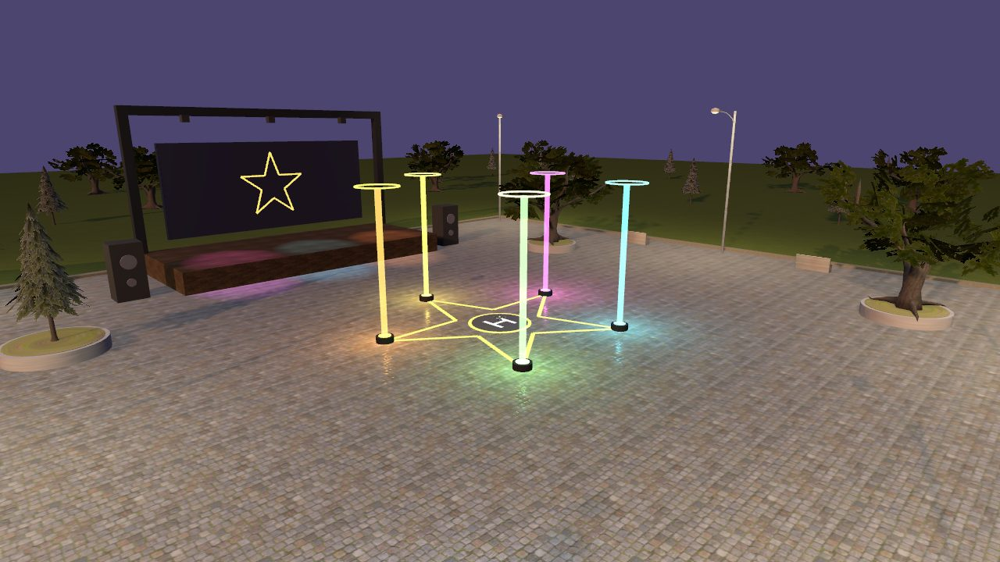
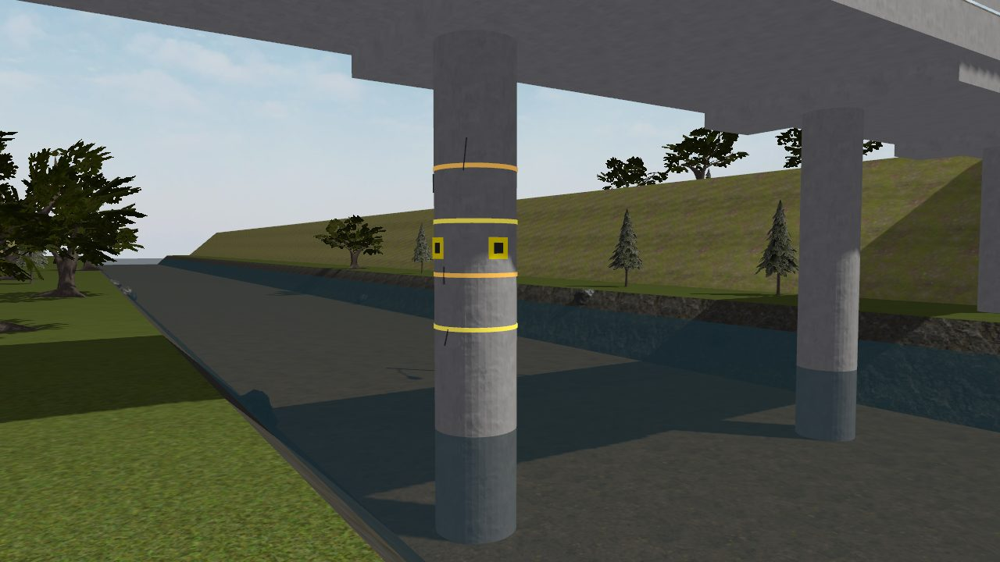
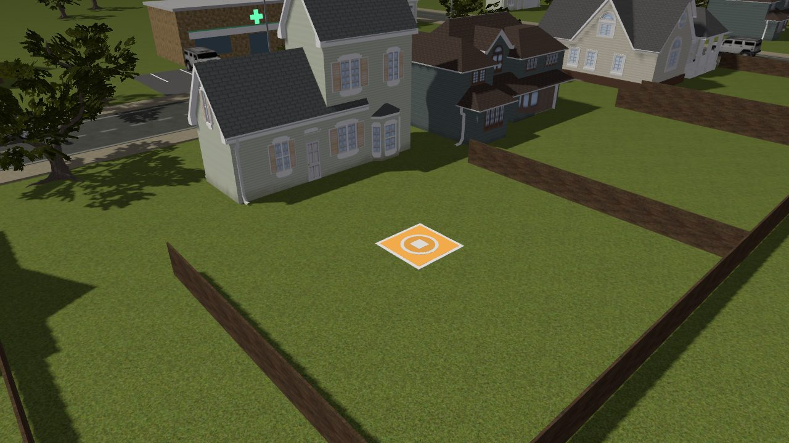
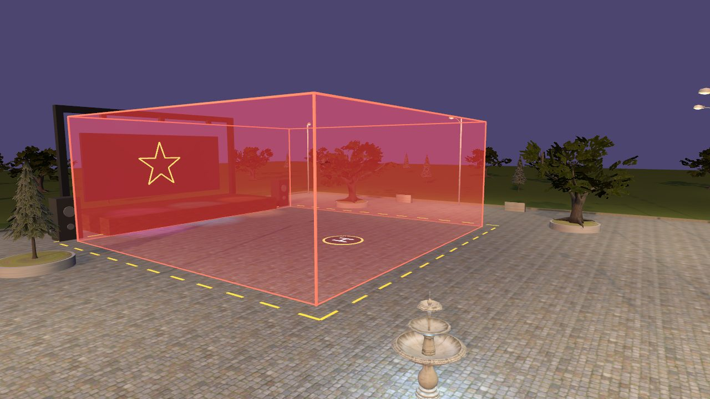
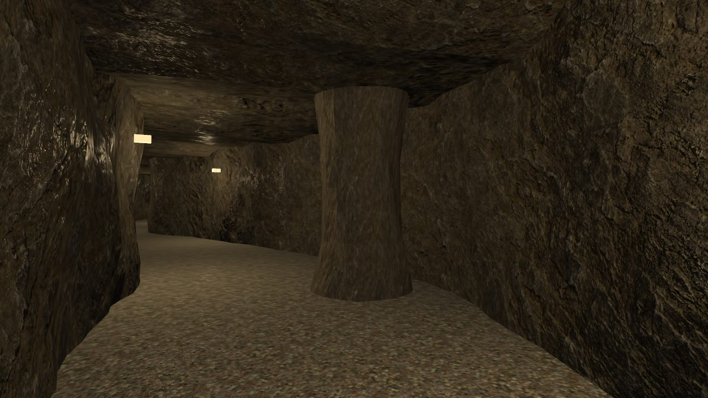
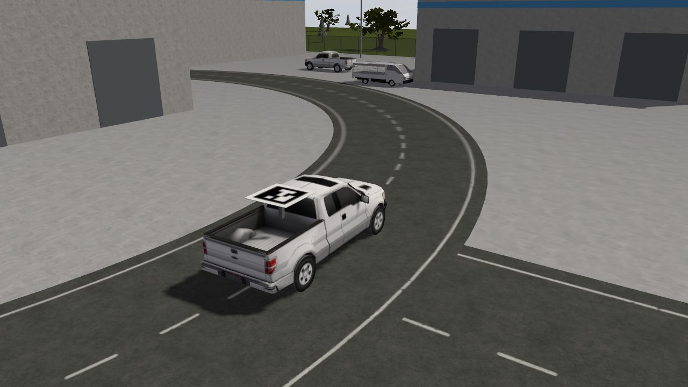
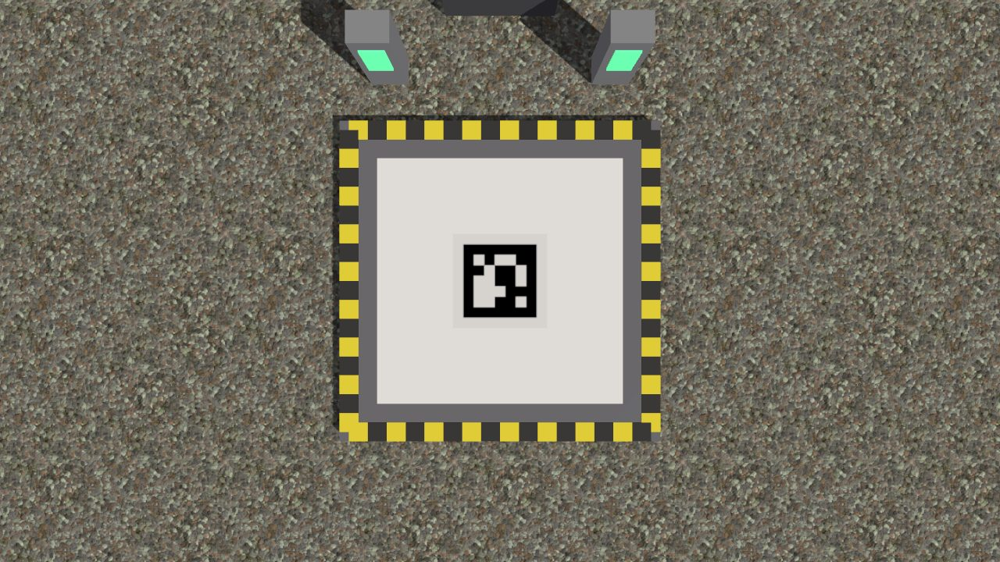

# x500_retos

Misiones del mundo real para el X500, 100 % en simulación. Cada misión tiene
su mundo de Gazebo y un nodo con la máquina de estados lista y **las piezas
por resolver marcadas con `TODO`**. Si un TODO no está hecho, el nodo vuela
de todos modos de forma segura (despega, avisa, regresa y aterriza) y al
final dice si la misión se cumplió.

```bash
vespo build
vespo up --sim --world <mundo>                 # terminal 1
ros2 run x500_retos <nodo>                     # terminal 2
```

## Nivel 1 — Moverse bien

| # | Misión | Mundo | Nodo | Qué se aprende |
|---|---|---|---|---|
| 1 | Estrella del show | `plaza_show` | `estrella_show` | Generar waypoints con una fórmula (estrella o polígono de N picos) |
| 2 | Inspección de un pilar | `puente_rio` | `inspeccion_pilar` | Hélice con feedforward y yaw siempre al pilar |
| 3 | Entrega a domicilio | `barrio_entrega` | `entrega_domicilio` | Misión por etapas con comandos de PX4 (Takeoff, GPS, Land, Return) |





## Nivel 2 — Decidir solo

| # | Misión | Mundo | Nodo | Qué se aprende |
|---|---|---|---|---|
| 4 | Geocerca del concierto | `plaza_concierto` | `guardian_geocerca` | Un nodo que no vuela: predice dónde frenaría el dron y, si eso queda fuera de la caja roja, Hold y Return |
| 5 | Cruzar una cueva | `cueva` (modelo `x500_lidar_2d`) | `cruzar_cueva` | Control reactivo con el lidar 2D: centrarse, girar hacia el hueco y esquivar la columna |

```bash
# Misión 4: el guardián vigila; vuelo_prueba (ya hecho) se escapa a propósito
vespo up --sim --world plaza_concierto
ros2 run x500_retos guardian_geocerca
ros2 run x500_retos vuelo_prueba --ros-args -p direction_deg:=0.0 -p speed:=6.0
#   (o vuela a mano desde QGC e intenta salirte de la caja)

# Misión 5: el launch levanta el puente del lidar (ros_gz_bridge) y el nodo
vespo up --sim --world cueva --custom x500_lidar_2d
ros2 launch x500_retos cueva.launch.py
```




## Nivel 3 — Ver con cámara

Percepción y control separados: `detector_aruco` mira la cámara y publica en
`/x500/aruco` lo que ve (mensaje `x500_retos/ArucoArray`); las misiones leen
eso y deciden. El launch de cada misión levanta el puente de la cámara
(ros_gz_bridge), el detector y la misión.

| # | Misión | Mundo | Nodo | Qué se aprende |
|---|---|---|---|---|
| — | Los ojos | — | `detector_aruco` | OpenCV `cv::aruco`: de la imagen a id + centro + ángulo |
| 6 | Caza del objetivo | `zona_bodegas` | `caza_objetivo` | Barrido, ignorar señuelos (3, 12, 25), estimar la velocidad del ArUco 7 y seguirlo |
| 7 | Estación de carga | `base_carga` | `estacion_carga` | Patrulla; con batería baja, aterrizaje de precisión sobre el ArUco 42, "carga" y regreso a la patrulla |

```bash
vespo up --sim --world zona_bodegas --custom x500_cam_abajo
ros2 launch x500_retos caza.launch.py

vespo up --sim --world base_carga --custom x500_cam_abajo
ros2 launch x500_retos estacion.launch.py

ros2 run rqt_image_view rqt_image_view /x500/aruco/debug   # lo que ve el detector
```

- **Modelo `x500_cam_abajo`** (en `models/`): el x500 de PX4 con una cámara
  hacia abajo de 960 x 720 a 15 Hz. La de PX4 (`x500_mono_cam_down`) es de
  1280 x 960 a 30 Hz: mucho tráfico para pasarla a ROS en una laptop.
- **Los mundos con cámara no cargan `GstCameraSystem`** (el plugin de video de
  PX4): sin CUDA su codificador no alcanza y acumula imágenes hasta llenar la
  RAM (a nosotros nos trabó la computadora). Ver `CAMERA_WORLD_SYSTEMS` en
  `tools/build_worlds.py`.
- **La cámara no tiene gimbal**: si el dron se inclina, la imagen se corre.
  `aruco_tools.hpp` gira el rayo de cada píxel con la actitud completa del dron
  (cuaternión de PX4) antes de pasarlo a metros.
- La camioneta sospechosa da vueltas sola al anillo vial (3 m/s, radio 26.5 m)
  con el plugin VelocityControl de Gazebo: eso solo existe en simulación.
- La batería de PX4 SITL baja de 100 % a 50 % en 30 s armado y vuelve a 100 % al
  desarmar: aterrizar en la estación y desarmar es "cargar".




**QGroundControl abierto.** PX4 no arma sin una estación de tierra conectada
(`NAV_DLL_ACT = 2` por defecto). `vespo up --sim` ya abre QGC; si corres
`vespo simulate` solo, ábrelo con `vespo qgc`.

Parámetros sin recompilar, p. ej.:

```bash
ros2 run x500_retos estrella_show --ros-args -p points:=4 -p inner_ratio:=0.0   # cuadrado
ros2 run x500_retos inspeccion_pilar --ros-args -p turns:=2.0 -p speed:=1.5
ros2 run x500_retos entrega_domicilio --ros-args -p cruise_alt:=20.0
```

## Cómo está hecho

- `include/x500_retos/px4_link.hpp`: suscripciones, comandos y offboard que
  todas las misiones comparten. El tiempo de las misiones sale de
  `px4_.clock()` (el reloj de PX4), no del de la pared: en SITL así la
  trayectoria no se adelanta si Gazebo va lento.
- Todos los mundos: el dron aparece en (0, 0) mirando al norte, así que
  PX4 x (norte) = Gazebo y, PX4 y (este) = Gazebo x.
- Los mundos se generan con `tools/build_worlds.py` (mallas con texturas a
  escala y el `.sdf`). Para mover algo se cambia ahí y se corre de nuevo.
- Modelos de Fuel y texturas de ambientCG copiados en `models/` (funciona sin
  internet). Licencias en `CREDITS.md`.
- `tools/make_aruco.py` genera las texturas ArUco (`models/x500_aruco/`) y
  `tools/render_world.py` toma las fotos de `docs/img` sin abrir Gazebo; los
  dos con el venv del repo (`/data/vespo_ws/venv/bin/python`, trae OpenCV).
